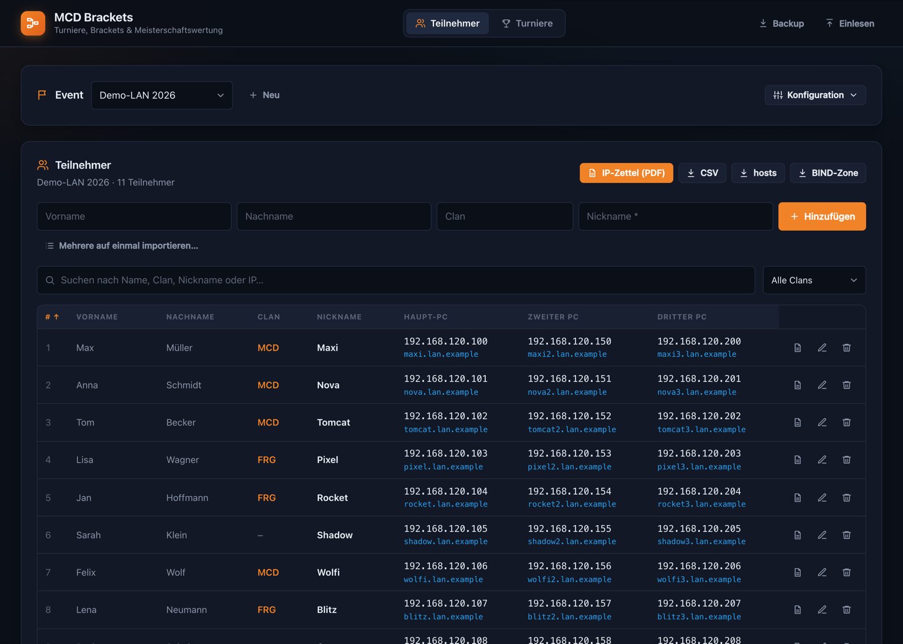
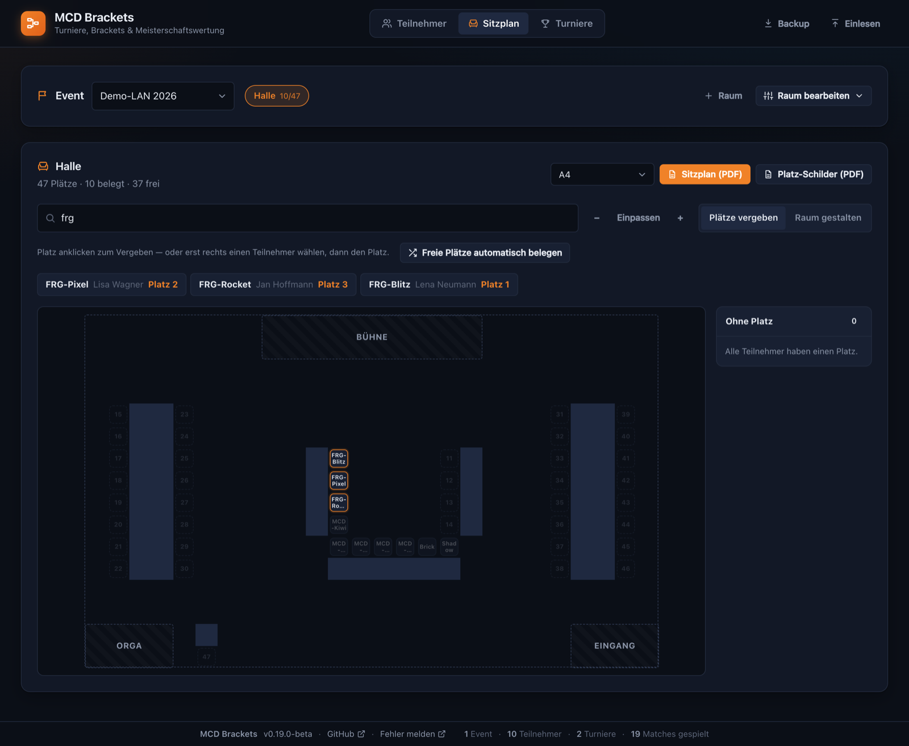
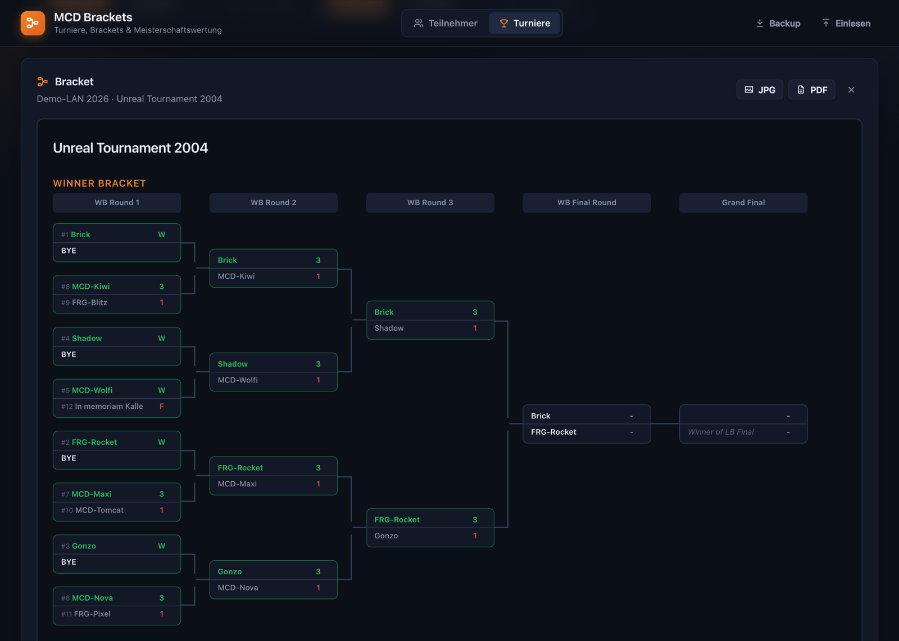
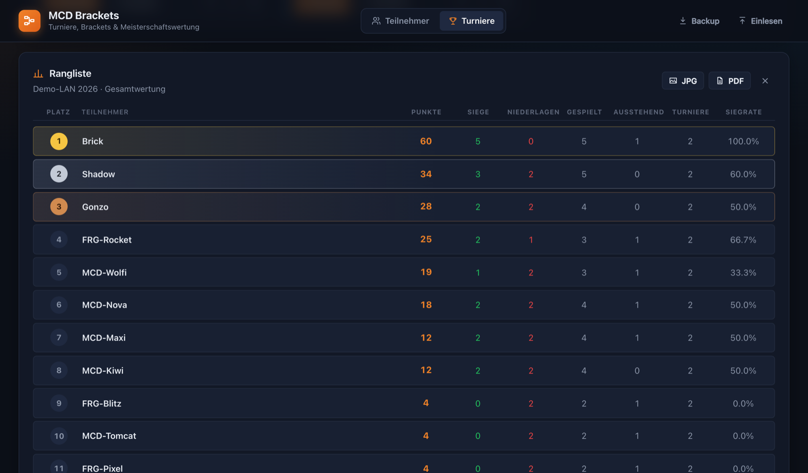
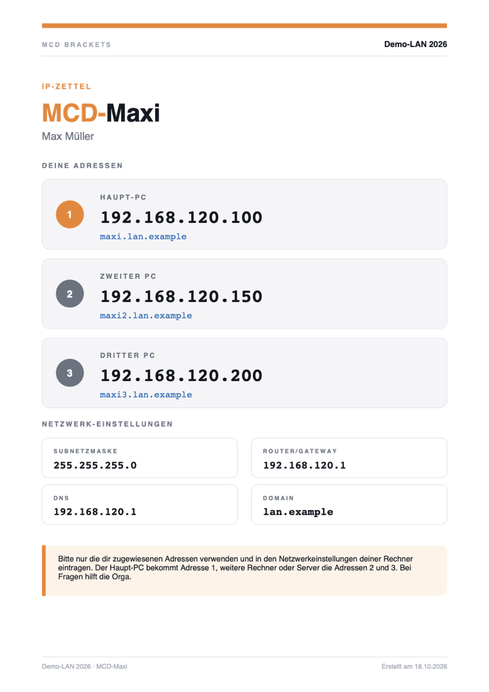

# MCD Brackets — Tournament Management System

Ein vollständiges Turnierverwaltungssystem mit Event-basiertem Meisterschafts-Punktesystem, entwickelt mit [brackets-manager](https://www.npmjs.com/package/brackets-manager).

**Version:** 0.19.0-beta

---

## Screenshots

**Teilnehmer-Verwaltung** — Teilnehmer mit Clan, Nickname, drei IP-Adressen und DNS-Namen; sortier- und filterbar, Export als IP-Zettel (PDF), CSV, hosts oder BIND-Zone



**Sitzplan** — Räume frei aus Tischreihen, U-Formen und Flächen zusammenstellen, Plätze per Klick vergeben; die Suche zeigt, wer wo sitzt



**Bracket** — Double Elimination mit Click-to-Win; ein Eintrag „In Gedenken“ verliert sein Match automatisch (F)



<table>
  <tr>
    <td width="62%" valign="top"><b>Gesamtwertung eines Events</b><br></td>
    <td width="38%" valign="top"><b>IP-Zettel (A4-PDF pro Teilnehmer)</b><br></td>
  </tr>
</table>

<sub>Alle Namen in den Screenshots sind Demo-Daten.</sub>

---

## Features

### 🏆 Turnier-Formate
- **Single Elimination** — K.O.-System
- **Double Elimination** — Doppel-K.O. mit Winner & Loser Bracket
  - Optional: Grand Final (Simple oder Double)
  - Automatische BYE-Generierung für Power-of-2
- **Round-Robin** — Jeder gegen Jeden (Ranking nach 3/1/0 Punkten)

### 🎯 Event-Management
- **Multi-Turnier Events** — Mehrere Turniere pro Event
- **Zufällige Paarungen** — Fisher-Yates Shuffle beim Turnier-Start (serverseitig)
- **Event-Filter** — Turniere nach Events filtern
- **Gesamt-Rankings** — Event-übergreifende Ranglisten

### 👥 Teilnehmer-Verwaltung
- **Teilnehmer pro Event** — Vorname, Name, Clan und Nickname; angezeigt und in Turnieren gespielt als `Clan-Nickname`; aus einem anderen Event (z.B. Vorjahr) übernehmbar
- **Liste filtern & sortieren** — Suche, Clan-Filter, Sortieren per Klick auf Vorname, Nachname, Clan, Nickname oder #
- **Bulk-Import** — Liste im Format `Nachname, Vorname // Clan-Nickname` einfügen (Clan endet am ersten Bindestrich), mit Vorschau (IPs und Fehler pro Zeile) vor dem Import
- **3 IP-Adressen pro Teilnehmer** — aus drei einstellbaren Bereichen (Haupt-PC, Zweiter PC, Dritter PC) mit gleichem Versatz, z.B. `.100` / `.150` / `.200`; freie Plätze werden wiederverwendet
- **DNS-Namen** — `nickname`, `nickname2`, `nickname3` (ohne Clan) unter der einstellbaren Domain (Umlaute und Sonderzeichen werden DNS-tauglich umgewandelt)
- **IP-Zettel (PDF)** — ein DIN-A4-Blatt pro Teilnehmer mit Logo (Hochformat, oben rechts), Clan-Nickname, Name, den 3 IPs samt DNS-Namen und den Netzwerk-Einstellungen; einzeln (Icon in der Liste) oder für alle als ein PDF. Alle PDFs halten einen Druckrand von mind. 5 mm ein
- **Exporte** — CSV (Excel), hosts-Datei (dnsmasq/Pi-hole), BIND-Zone
- **Automatische Spieler** — Turniere nehmen alle Teilnehmer ihres Events (per Nickname); „Neu auslosen“ übernimmt neu hinzugekommene

### 🏅 Punktesystem & Rankings
Platzierungsbasierte Punkte:

| Platz | Punkte |
|-------|--------|
| 1     | 30     |
| 2     | 22     |
| 3     | 16     |
| 4     | 12     |
| 5     | 9      |
| 6     | 7      |
| 7     | 5      |
| 8     | 3      |
| 9–12  | 2      |
| 13+   | 1      |

- **Korrekte Double Elimination Platzierung** — Basierend auf erreichter Bracket-Runde
- **Event-Meisterschaft** — Gesamtpunkte über alle Turniere eines Events
- **Einzelturnier-Rankings** — Detaillierte Statistiken pro Turnier

### 📊 Bracket-Visualisierung
- **Interactive Brackets** mit [brackets-viewer.js](https://github.com/Drarig29/brackets-viewer.js)
- **Dark Theme** — Vollständig angepasstes Farbschema
- **Click-to-Win** — Gewinner direkt im Bracket auswählen
- **Smart Validierung** — Unterscheidung zwischen BYE und TBD Matches
- **Export** — Bracket & Rankings als JPG oder PDF

### ⚙️ Turnierverwaltung
- **Teilnehmer bearbeiten** — Mit automatischer Bracket-Regeneration
- **Bracket zurücksetzen** — Mit neuer zufälliger Auslosung
- **Cascade Delete** — Stage-Löschung entfernt alle Participants serverseitig
- **Match-Filter** — Nur offene Matches, TBD ausblenden
- **Collapsible Sections** — Aufgeräumte Benutzeroberfläche

### 🔒 Admin-Passwort
- Mit der Umgebungsvariable `ADMIN_PASSWORD` dürfen nur angemeldete Admins Turniere, Ergebnisse, Teilnehmer und Event-Einstellungen ändern sowie Backups laden/einspielen
- Ansehen (Brackets, Ranglisten, Teilnehmerliste, IP-Zettel, Exporte) bleibt ohne Anmeldung möglich; Bearbeiten-Elemente werden dann ausgeblendet
- Anmeldung über „Anmelden“ oben rechts, gültig 7 Tage (signiertes HttpOnly-Cookie); ein neues Passwort beendet alle Sitzungen
- Ohne `ADMIN_PASSWORD` darf jeder bearbeiten (wie bisher)
- Einrichtung siehe [Admin-Passwort einrichten](#admin-passwort-einrichten)

### 🪑 Sitzplan
- Reiter „Sitzplan“: pro Event beliebig viele Räume (z.B. Halle, Nebenraum), jeweils eine freie Fläche (Breite × Tiefe in Feldern, 1 Feld ≈ ein Platz)
- **Baukasten:** Tischreihe (Plätze beidseitig, einseitig oder keine), Doppelreihe (Tische Rücken an Rücken), U-Form (Plätze innen), Reihenblock (mehrere Doppelreihen), beschriftete Flächen (Bühne, Orga, Eingang …) und **Türen** in der Wand — mit Breite, Anschlag und Öffnungsrichtung nach innen oder außen (der Rand um den Raum ist nur für nach außen öffnende Türen da; der Schwenkbereich nach innen bleibt frei, Tische darin werden rot markiert)
- Gruppen frei **verschieben** (ziehen oder Pfeiltasten), in 90°-Schritten **drehen**, duplizieren, löschen; mehrere per Shift-Klick oder Rahmen markieren und gemeinsam bewegen/drehen — so entstehen U-Formen, Tische nur in der Raummitte oder beliebige Kombinationen. Überlappungen werden rot markiert
- **Platznummern frei gestaltbar:**
  - automatisch 1, 2, 3 … in der Reihenfolge der Gruppen („Nr. ↑/↓“, „Nach Position nummerieren“), innerhalb einer Reihe der Reihe nach, rückwärts, rundherum oder rundherum rückwärts („Nummern ⇄“)
  - **eigener Bereich pro Reihe** über „Start-Nr.“ (z.B. 101, M1 oder A-01) — die Reihe zählt in ihrer Richtung davon aus hoch (Ziffer am Ende)
  - automatische Nummern überspringen die Startbereiche, doppelte Nummern werden rot markiert und oben genannt
  - Belegungen hängen am Platz und bleiben beim Verschieben, Drehen und Umnummerieren erhalten
- Darstellung: auf den Tischen steht nur der Nickname (bis zu zwei Zeilen, sonst am Ende mit „…“ gekürzt); Platznummer, Clan-Nickname und Name zeigt ein Tooltip über Tisch oder Stuhl (auf dem Handy per Tippen). Im Modus „Raum gestalten“ zeigen die Tische ihre Nummer. Nummerierte Felder sind die Tische (ein Tisch = ein Platz, belegt orange umrandet), daneben stehen Stühle (von oben gesehen), die zum jeweiligen Tisch zeigen — bei Tischen Rücken an Rücken zwei Stühle pro Feld; Legende unter dem Plan
- Admins vergeben Plätze per Klick auf den Platz oder erst Teilnehmer aus „Ohne Platz“ wählen, dann Platz anklicken. „Freie Plätze automatisch belegen“ setzt alle ohne Platz, Clans zusammen
- Jeder kann suchen, wer wo sitzt (Name, Clan, Nickname oder Platznummer) — Treffer werden im Plan hervorgehoben, ein Klick springt zum Platz. Der Plan passt sich automatisch an die Fensterbreite an (Zoom mit −/+)
- PDF: **Sitzplan** (A4/A3, Raumplan mit Namen + alphabetische Liste „Wer sitzt wo?“) und **Platz-Schilder** (Tischaufsteller zum Falten, zwei pro A4-Blatt, von beiden Seiten lesbar)
- **Alternativen:** Räume lassen sich als Alternative (Entwurf) kennzeichnen — beim Duplizieren oder unter „Raum bearbeiten“. Dort darf jeder Teilnehmer zusätzlich zu seinem Platz im finalen Plan sitzen (innerhalb der Alternative einmal); „Ohne Platz“ und „automatisch belegen“ beziehen sich nur auf diesen Raum. Nimmt man das Häkchen weg, wird die Alternative final und ihre Teilnehmer werden aus den anderen finalen Räumen freigegeben. Alternativen sind nur angemeldet sichtbar
- **Alle Plätze freigeben** leert die Belegung eines Raums (mit Rückfrage)
- Räume **duplizieren** („Duplizieren“ neben „+ Raum“): Kopie mit Tischgruppen, Türen und Startnummern — ins selbe oder ein anderes Event, ohne Belegung
- Ein neues Event übernimmt die Räume des letzten Events (ohne Belegung)

### 🔥 OPNsense / Unbound
- Überträgt die DNS-Namen eines Events per OPNsense-API als **Host Overrides** nach Unbound (getestet gegen die API von OPNsense 26.7)
- Erst Vorschau (neu / geändert / gelöscht / Konflikt), dann „Übertragen“; danach wird Unbound automatisch neu geladen
- Ändert und löscht nur eigene Einträge (Beschreibung beginnt mit `mcd-brackets #<Event>`), von Hand angelegte Einträge mit gleichem Namen werden als Konflikt angezeigt und nicht überschrieben
- „Einträge entfernen…“ löscht nach der LAN alle Einträge des Events wieder

### 🕯️ In Gedenken
- Pro Event eine Liste von Namen (Konfiguration → „In Gedenken“), z.B. für verstorbene Mitglieder
- Sie stehen in jedem Turnier des Events mit ihrem Namen im Bracket; sie verlieren ihre Matches automatisch, der Gegner kommt weiter
- Unter der Teilnehmerliste stehen sie als „Never forget … — immer dabei“
- Keine IP-Adressen, keine Platzierung/Punkte in den Ranglisten

### ℹ️ Footer
- Feste Leiste am unteren Fensterrand, immer sichtbar
- Aktuelle Version (Link zum Quellcode dieser Version), Links zu GitHub und „Fehler melden“
- Kurze Statistik: Events, Teilnehmer, Turniere, gespielte Matches (ohne Freilose)
- Hinweis „Neue Version … verfügbar“, wenn auf GitHub ein neuerer Versions-Tag existiert

### 💾 Datenbank-Backup & Restore
- **Backup herunterladen** — `db.json` als timestamped JSON-Datei exportieren
- **Backup einlesen** — JSON-Backup validieren und wiederherstellen
- Vor jedem Restore wird automatisch eine Sicherheitskopie der aktuellen DB angelegt

---

## Installation

### Docker (empfohlen)

Die `docker-compose.yml` nutzt das fertige Image `ghcr.io/lordimac/mcd.brackets:latest`, das die GitHub Action bei jedem Push auf `main` baut. Es reichen `docker-compose.yml` und `.env`, der Quellcode wird nicht gebraucht:

```bash
echo "ADMIN_PASSWORD=mein-passwort" > .env   # siehe „Admin-Passwort einrichten“
docker compose up -d
```

Öffne [http://localhost:3000](http://localhost:3000) im Browser.

**Update auf die neueste Version:**
```bash
docker compose pull && docker compose up -d
```

**Aus dem Quellcode bauen mit `npm run docker:rebuild`** (Image `mcd-brackets` + Container auf Port 3001, Daten in `./data`): Das Skript liest `.env`, sichert vor dem Neustart `data/db.json` als `data/db-before-rebuild-<zeit>.json` (die letzten 10 bleiben) und wartet, bis der Container healthy ist.

**Ohne Compose:**
```bash
docker pull ghcr.io/lordimac/mcd.brackets:latest
docker run -d -p 3000:3000 -v $(pwd)/data:/app/data -e ADMIN_PASSWORD='geheim' ghcr.io/lordimac/mcd.brackets:latest
```

### Admin-Passwort einrichten

Das Passwort steht in der Datei `.env` im Projektordner (von Git und vom Docker-Image ausgeschlossen, Vorlage: `.env.example`):

```bash
ADMIN_PASSWORD=mein-geheimes-passwort
```

- `docker compose` und `npm run docker:rebuild` lesen `.env` automatisch; nach einer Änderung den Container neu erstellen (`docker compose up -d` bzw. `npm run docker:rebuild`)
- Ohne Compose: `docker run … -e ADMIN_PASSWORD='…'` (siehe oben)
- Development: `ADMIN_PASSWORD='…' npm run server`
- Leer oder nicht gesetzt = keine Anmeldung nötig, jeder darf bearbeiten. Der Server meldet das beim Start als Warnung
- Ein neues Passwort meldet alle angemeldeten Browser ab

### NPM (Development)

```bash
npm install
npm run server
```

Development Mode mit Auto-Reload:
```bash
npm run server:watch
```

Tests und Build:
```bash
npm test
npm run build && npm start
```

Umgebungsvariablen:

| Variable   | Standard | Beschreibung |
|------------|----------|--------------|
| `PORT`     | `3000`   | HTTP-Port |
| `DATA_DIR` | `./data` | Verzeichnis für `db.json` und Restore-Sicherungen |
| `ADMIN_PASSWORD` | *(leer)* | Passwort zum Bearbeiten; leer = jeder darf bearbeiten. Für `docker compose` und `npm run docker:rebuild` in `.env` eintragen (`ADMIN_PASSWORD=…`, nicht im Git) |
| `UPDATE_CHECK` | `true` | Prüft beim Start und alle 6 Stunden auf GitHub, ob es eine neuere Version gibt (Hinweis im Footer). Ohne Internet passiert einfach nichts; `false` schaltet den Check ab |

---

## Webinterface

### Teilnehmer verwalten (Reiter „Teilnehmer“, erster Reiter)
1. Event anlegen („Neu“) — Domain und IP-Bereiche werden vom letzten Event übernommen
2. Unter „Konfiguration“ (einklappbar) Domain, Logo, Netzwerk (Subnetzmaske, Router/Gateway, DNS — stehen auf den IP-Zetteln) und die drei IP-Bereiche einstellen
3. Teilnehmer mit Vorname, Name und Nickname hinzufügen — einzeln oder per „Mehrere auf einmal importieren…“ (`Nachname, Vorname // Clan-Nickname`, eine Zeile pro Teilnehmer). IPs und DNS-Namen werden automatisch vergeben, beim Import in der Reihenfolge der Nachnamen
4. IP-Zettel als PDF drucken („IP-Zettel (PDF)“ für alle, Datei-Icon in der Zeile für einzelne) und bei Bedarf CSV, hosts-Datei oder BIND-Zone herunterladen
5. Optional: DNS-Namen mit „OPNsense“ nach Unbound übertragen (siehe unten)

### Sitzplan (Reiter „Sitzplan“)
1. Event wählen, mit „+ Raum“ einen Raum anlegen (Breite und Tiefe in Feldern, unter „Raum bearbeiten“ änderbar)
2. „Raum gestalten“: Baustein wählen (Tischreihe, Doppelreihe, U-Form, Reihenblock, Fläche), Größe einstellen, „Hinzufügen“ — vorher auf eine freie Stelle im Raum klicken, dann landet er dort (oder an der nächsten freien Stelle), sonst am ersten freien Platz. Freie Flächen innerhalb einer U-Form zählen mit
3. Gruppen an die richtige Stelle ziehen, mit „Drehen“ (<kbd>R</kbd>) ausrichten, mit „Duplizieren“ vervielfachen; Türen per Baustein „Tür“ an die nächste Wand setzen und entlang der Wand verschieben
4. „Plätze vergeben“: Plätze anklicken und Teilnehmer wählen — oder „Freie Plätze automatisch belegen“
5. „Sitzplan (PDF)“ zum Aushängen, „Platz-Schilder (PDF)“ für die Tische

### OPNsense anbinden
1. In OPNsense unter **System → Zugang → Benutzer** einen eigenen Benutzer für die API anlegen und ihm die Berechtigung **„Services: Unbound“** geben (enthält Host Overrides und das Neuladen von Unbound)
2. Beim Benutzer unter **API-Schlüssel** einen Schlüssel erzeugen — OPNsense lädt eine Datei mit `key` und `secret` herunter
3. In MCD Brackets unter **Teilnehmer → Konfiguration → OPNsense** Adresse der Firewall (z.B. `https://192.168.120.1`), API-Key und Secret eintragen. Beim Standard-Zertifikat der OPNsense „Zertifikat nicht prüfen“ aktivieren. „Verbindung testen“, dann „Speichern“
4. Beim Event muss eine **Domain** eingetragen sein. Der Button **„OPNsense“** über der Teilnehmerliste zeigt die Vorschau, „Übertragen“ schreibt die Einträge

Die Zugangsdaten gelten für alle Events und liegen in der Datenbank (`db.json`, damit auch im Backup). Das Secret wird nach dem Speichern nie wieder an den Browser geschickt; die Einstellungen sind nur angemeldet sichtbar. Der Container muss die Firewall im Netz erreichen können.

### Turnier erstellen (Reiter „Turniere“)
1. Event auswählen — alle Teilnehmer des Events spielen mit
2. Turnier-Name eingeben
3. Typ wählen (Single/Double Elimination oder Round Robin)
4. Optional: Grand Final mit Rückspiel für Double Elimination

### Bracket anzeigen & bearbeiten
- **Gewinner auswählen**: Klick auf Match → Gewinner wählen
- **BYE-Matches**: Werden automatisch entschieden
- **TBD-Matches**: Noch nicht spielbar, warte auf vorherige Matches

### Rankings
- **Einzelturnier**: Rangliste mit Platzierung und Statistiken
- **Event-Gesamt**: Kombinierte Rangliste über alle Turniere
- **Top-3 Highlighting**: Gold / Silber / Bronze

### Anmelden
Ist ein Admin-Passwort gesetzt, sieht man ohne Anmeldung nur die Ansicht. „Anmelden“ oben rechts → Passwort eingeben → alle Bearbeiten-Funktionen erscheinen. „Abmelden“ beendet die Sitzung.

### Backup & Restore
Oben rechts in der Kopfleiste (nur angemeldet):
- **💾 Backup herunterladen** — Lädt die aktuelle `db.json` herunter
- **📂 Backup einlesen** — Stellt eine gesicherte `db.json` wieder her

---

## REST API

Ist `ADMIN_PASSWORD` gesetzt, sind alle Anfragen außer GET/HEAD (und `GET /api/backup`) nur mit Admin-Sitzung erlaubt, sonst `401`.

### Anmeldung
| Method | Endpoint | Beschreibung |
|--------|----------|--------------|
| GET    | `/api/auth` | `{ required, admin }` — ist ein Passwort gesetzt, ist der Browser angemeldet |
| POST   | `/api/login` | Anmelden `{ password }` → setzt das Cookie `mcd_admin` (7 Tage) |
| POST   | `/api/logout` | Abmelden (Cookie löschen) |

### Stages
| Method | Endpoint | Beschreibung |
|--------|----------|--------------|
| GET    | `/api/stages` | Alle Stages abrufen |
| POST   | `/api/stages` | Neue Stage erstellen — Body: `{ name, type, eventName, settings?, participants? }`; ohne `participants` spielen alle Teilnehmer des Events. Turnier-ID, Auslosung und BYEs vergibt der Server |
| POST   | `/api/stages/:id/regenerate` | Stage neu auslosen mit den aktuellen Teilnehmern des Events (oder `{ participants: string[] }`); Einstellungen und Event bleiben erhalten, bei Fehlern wird zurückgerollt |
| DELETE | `/api/stages/:id` | Stage + Participants löschen |

### Matches
| Method | Endpoint | Beschreibung |
|--------|----------|--------------|
| GET    | `/api/matches` | Alle Matches abrufen |
| PUT    | `/api/matches/:id` | Match-Ergebnis aktualisieren |

### Participants
| Method | Endpoint | Beschreibung |
|--------|----------|--------------|
| GET    | `/api/participants` | Alle Teilnehmer abrufen |
| DELETE | `/api/participants/:id` | Teilnehmer löschen |

### Viewer & Standings
| Method | Endpoint | Beschreibung |
|--------|----------|--------------|
| GET    | `/api/viewer-data/:stageId` | Turnierdaten für Bracket-Viewer |
| GET    | `/api/standings/:stageId` | Platzierungen inkl. Punkten: `{ placement, participant_id, participant_name, wins, losses, pending, points }` |

### Events & Teilnehmer
| Method | Endpoint | Beschreibung |
|--------|----------|--------------|
| GET    | `/api/events` | Events inkl. Anzahl Teilnehmer, Plätze und Turniere |
| POST   | `/api/events` | Event anlegen `{ name, domain?, dns_server?, netmask?, gateway?, ranges? }` (fehlende Werte vom letzten Event) |
| PUT    | `/api/events/:id` | Event ändern (inkl. `logo`, `memorial: string[]`); Umbenennen wirkt auch auf die Turniere |
| DELETE | `/api/events/:id` | Event mit Teilnehmern löschen (nur ohne Turniere) |
| GET    | `/api/events/:id/attendees` | Teilnehmer inkl. `ips` und `dns_names` |
| POST   | `/api/events/:id/attendees` | Teilnehmer anlegen `{ first_name, last_name, clan, nickname }` |
| POST   | `/api/events/:id/attendees/import` | Teilnehmer aus `{ fromEventId }` übernehmen |
| POST   | `/api/events/:id/attendees/bulk` | Bulk-Import `{ text, dryRun? }` — Zeilen `Nachname, Vorname // Clan-Nickname`; liefert pro Zeile Ergebnis oder Fehler, `dryRun: true` schreibt nichts |
| PUT    | `/api/attendees/:id` | Teilnehmer ändern; neuer Clan/Nickname wird in den Turnieren übernommen |
| DELETE | `/api/attendees/:id` | Teilnehmer löschen (IPs werden frei) |
| GET    | `/api/events/:id/export/csv\|hosts\|zone` | Export als CSV, hosts-Datei oder BIND-Zone |

### Sitzplan
Lesen ist öffentlich, Ändern nur mit Admin-Sitzung. Ein Raum hat `width` × `height` Felder und `groups`: Tischreihen `{ id, type: "row", x, y, rotation: 0|90|180|270, length, sides: "both"|"one"|"none", numbering?: "forward"|"backward"|"around"|"around-back", start_label?: string }` und Flächen `{ id, type: "area", x, y, width, height, label }`; dazu `doors`: `{ id, side: "top"|"right"|"bottom"|"left", offset, width, swing: "in"|"out", hinge: "start"|"end" }`. Platz-Schlüssel `"<gruppe>.<b|f><index>"` (z.B. `g3.f2`). Antworten enthalten zusätzlich `layout` mit den Zellen jeder Gruppe, allen Plätzen (`key`, `number` = Reihenfolge, `label` = angezeigte Platznummer, `x`, `y`), Überlappungen und doppelten Nummern (`duplicates`).

| Method | Endpoint | Beschreibung |
|--------|----------|--------------|
| GET    | `/api/events/:id/rooms` | Räume inkl. `layout`, `alternative` und `seats: { "<platz>": attendeeId }` — Alternativen nur mit Admin-Sitzung |
| POST   | `/api/events/:id/rooms` | Raum anlegen `{ name, width?, height? }` (Standard 24 × 14) |
| PUT    | `/api/rooms/:id` | Name, Größe, Gruppen, Türen und/oder Alternative-Kennzeichen `{ name?, width?, height?, groups?, doors?, alternative? }` (`alternative: false` macht den Raum final und gibt seine Teilnehmer in anderen finalen Räumen frei); Gruppen müssen im Raum, Türen in ihrer Wand liegen; Plätze entfernter Gruppen werden frei |
| POST   | `/api/rooms/:id/templates` | Baustein einfügen `{ template: "row"\|"double"\|"u"\|"block"\|"area"\|"door", params, at?: { x, y } }` (Tür: an die Wand nächst `at`) — an `at` bzw. der nächsten freien Stelle, sonst am ersten freien Platz |
| POST   | `/api/rooms/:id/sort` | Gruppen nach Position sortieren (nummeriert die Plätze neu) |
| POST   | `/api/rooms/:id/duplicate` | Raum kopieren `{ name?, event_id?, alternative? }` — Layout, Türen, Startnummern; ohne Belegung. Ohne Name: „<Name> (Kopie)“ bzw. der Originalname, wenn er im Ziel-Event frei ist |
| DELETE | `/api/rooms/:id` | Raum löschen |
| PUT    | `/api/rooms/:id/seats/:key` | Platz vergeben `{ attendee_id }` oder freigeben `{ attendee_id: null }`; ein Teilnehmer hat höchstens einen Platz je Event → alle Räume |
| POST   | `/api/rooms/:id/clear` | Alle Plätze des Raums freigeben |
| POST   | `/api/rooms/:id/autofill` | Alle ohne Platz auf freie Plätze dieses Raums setzen → `{ rooms, seated, remaining }` |

### OPNsense
Alle Endpunkte nur mit Admin-Sitzung (auch GET). Fehler der Firewall kommen als `502` mit lesbarer Meldung.

| Method | Endpoint | Beschreibung |
|--------|----------|--------------|
| GET    | `/api/opnsense` | Verbindung `{ url, api_key, has_secret, insecure_tls, configured }` (ohne Secret) |
| PUT    | `/api/opnsense` | Speichern `{ url, api_key, api_secret?, insecure_tls }` — leeres Secret behält das gespeicherte |
| POST   | `/api/opnsense/test` | Verbindung mit den übergebenen (oder gespeicherten) Werten testen → `{ ok, host_count }` |
| POST   | `/api/events/:id/opnsense/preview` | Vorschau `{ mode: "sync" \| "remove" }` → `{ items, counts }` |
| POST   | `/api/events/:id/opnsense/apply` | Ausführen (plant gegen den aktuellen Stand neu) → `{ created, updated, deleted, conflicts, errors, reconfigured }` |

### Info
| Method | Endpoint | Beschreibung |
|--------|----------|--------------|
| GET    | `/api/info` | `{ version, repo_url, update: { latest, url, checked_at, available } \| null, stats: { events, attendees, tournaments, matches_played } }` |

### Backup & Restore
| Method | Endpoint | Beschreibung |
|--------|----------|--------------|
| GET    | `/api/backup` | `db.json` als Download |
| POST   | `/api/restore` | Backup einspielen (JSON body) |

---

## Technologien

**Backend:** Node.js 22+ (Docker: Node 24), Express 5, TypeScript 7  
**Frontend:** Vanilla JavaScript, HTML5, CSS3  
**Engine:** brackets-manager 1.11, brackets-json-db 1.0  
**Visualisierung:** brackets-viewer.js 1.9  
**Export:** html2canvas 1.4, jsPDF 4  

---

## Datenstruktur

Die Daten werden in `data/db.json` gespeichert (per Docker Volume persistent):

- `participant` — `{id, tournament_id, name}`
- `stage` — `{id, tournament_id, name, type, event_name, settings}`
- `match` — `{id, stage_id, round_id, group_id, opponent1, opponent2}`
- `group` — Bracket-Gruppen (Winner / Loser / Finals)
- `round` — Runden innerhalb der Gruppen
- `match_game` — Einzelspiele
- `event` — `{id, name, domain, dns_server, netmask, gateway, logo, ranges: [{start, end} ×3]}` — `logo` ist eine PNG/JPEG-Data-URL
- `attendee` — `{id, event_id, first_name, last_name, clan, nickname, hostname, slot}` — IPs ergeben sich aus `ranges[i].start + slot`

---

## Platzierungsberechnung

### Double Elimination
Die Platzierung basiert auf:
1. Erreichter Gruppe (Finals > Loser Bracket > Winner Bracket)
2. Gewonnen/Verloren in der letzten Runde
3. Gesamte Wins als Tiebreaker
4. Gesamte Losses (weniger = besser) als finaler Tiebreaker

### Single Elimination
Sortierung nach Wins → Losses.

### Round Robin
3 Punkte pro Sieg, 1 pro Unentschieden; Gleichstände löst brackets-manager über die Score-Differenz. Bei mehreren Gruppen kommen alle Gruppenersten vor allen Gruppenzweiten usw.

---

## Projekt-Struktur

```
mcd.brackets/
├── src/
│   ├── server.ts       # Express Server + REST API
│   ├── auth.ts         # Admin-Passwort, Sitzungs-Cookie
│   ├── db.ts           # Storage, Restore, Schreib-Lock, Rollback
│   ├── stages.ts       # Turniere anlegen, neu auslosen, löschen
│   ├── lan.ts          # IP-Vergabe, DNS-Namen, Exporte (reine Logik)
│   ├── lan-store.ts    # Events & Teilnehmer in der Datenbank
│   ├── lan-routes.ts   # REST-Routen für Events & Teilnehmer
│   ├── opnsense.ts     # Abgleich mit Unbound + OPNsense-API-Client
│   ├── opnsense-routes.ts # REST-Routen für OPNsense
│   ├── info.ts         # Footer: Versionscheck (GitHub-Tags) + Statistik
│   ├── seating.ts      # Sitzplan: Tischgruppen, Geometrie, Bausteine, Nummerierung (reine Logik)
│   ├── seating-store.ts # Räume & Platzvergabe in der Datenbank
│   ├── seating-routes.ts # REST-Routen für den Sitzplan
│   ├── standings.ts    # Platzierungen + Punktesystem
│   ├── seeding.ts      # Auslosung + BYEs
│   └── *.test.ts       # Tests (npm test)
├── public/
│   ├── index.html      # Webinterface
│   ├── app.js          # Frontend-Logik (Turniere)
│   ├── lan.js          # Frontend-Logik (Teilnehmer-Verwaltung)
│   ├── ip-slips.js     # IP-Zettel als PDF (jsPDF)
│   ├── opnsense.js     # OPNsense-Einstellungen + Übertragen-Dialog
│   ├── seating.js      # Sitzplan-Ansicht (Raum-Editor, Vergabe, Suche)
│   ├── seating-pdf.js  # Sitzplan und Platz-Schilder als PDF
│   ├── styles.css      # Dark Theme Styling
│   └── lib/            # Lokale Kopien der Browser-Libs (npm run vendor)
├── data/
│   └── db.json         # Turnierdaten (Docker Volume)
├── docs/screenshots/   # Bilder für diese README
├── scripts/
│   └── docker-rebuild.sh  # Image + Container lokal neu bauen (npm run docker:rebuild)
├── .env.example        # Vorlage für .env (ADMIN_PASSWORD)
├── docker-compose.yml
├── Dockerfile
├── package.json
└── README.md
```

---

## Lizenz

ISC
